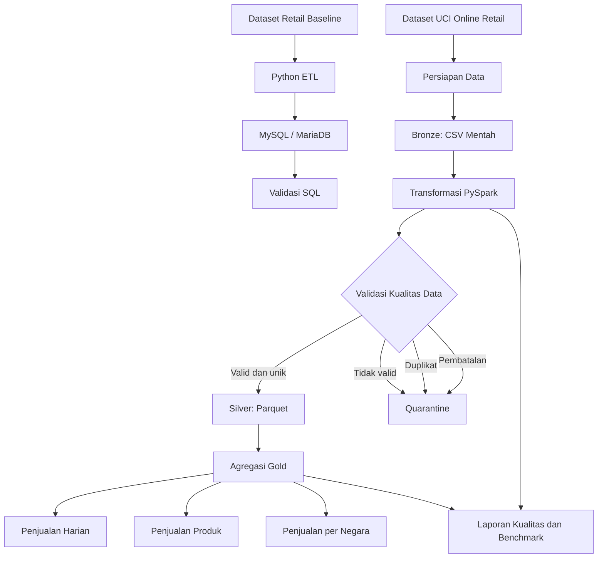

# Retail Sales ETL Pipeline

Proyek Data Engineering untuk membangun pipeline ETL (*Extract, Transform, Load*) data transaksi retail menggunakan Python, Apache Spark (PySpark), dan arsitektur data lake Bronze–Silver–Gold.

Proyek ini mencakup proses pengambilan data, transformasi, validasi kualitas data, deduplikasi, pemisahan data bermasalah (*quarantine*), agregasi analitik, serta pengukuran performa pipeline pada lingkungan lokal.

## Daftar Isi

- [Gambaran Umum Proyek](#gambaran-umum-proyek)
- [Tujuan Proyek](#tujuan-proyek)
- [Teknologi yang Digunakan](#teknologi-yang-digunakan)
- [Arsitektur Sistem](#arsitektur-sistem)
- [Struktur Folder](#struktur-folder)
- [Sumber Data](#sumber-data)
- [Alur Pemrosesan Data](#alur-pemrosesan-data)
- [Arsitektur Data Lake](#arsitektur-data-lake)
- [Validasi Kualitas Data](#validasi-kualitas-data)
- [Persiapan Lingkungan](#persiapan-lingkungan)
- [Menjalankan Pipeline](#menjalankan-pipeline)
- [Benchmark Performa](#benchmark-performa)
- [Validasi Data dengan SQL](#validasi-data-dengan-sql)
- [Output yang Dihasilkan](#output-yang-dihasilkan)
- [Keterbatasan dan Pengembangan Selanjutnya](#keterbatasan-dan-pengembangan-selanjutnya)
- [Penulis](#penulis)

## Gambaran Umum Proyek

Retail Sales ETL merupakan proyek Data Engineering yang berfokus pada pengolahan data transaksi retail menjadi data terstruktur yang siap digunakan untuk analisis.

Proyek ini memiliki dua alur pemrosesan:

1. **Pipeline baseline:** mengolah dataset retail awal menggunakan Python dan memuat data bersih ke MySQL/MariaDB.
2. **Pipeline data lake:** mengolah dataset retail publik menggunakan PySpark dan menyimpan data ke dalam layer Bronze, Silver, dan Gold menggunakan CSV dan Apache Parquet.

Pipeline data lake dirancang untuk diuji secara bertahap, dimulai dari target 100.000 baris hingga volume yang lebih besar sesuai kapasitas perangkat.

Pengembangan dilakukan pada Windows menggunakan Ubuntu melalui WSL2. Apache Spark dijalankan dalam mode lokal, bukan pada cluster yang terdiri dari beberapa mesin.

## Tujuan Proyek

Tujuan utama proyek ini adalah:

- Membangun pipeline ETL batch yang dapat dijalankan kembali.
- Memahami penggunaan Apache Spark dan PySpark untuk pemrosesan data.
- Menerapkan arsitektur data lake Bronze–Silver–Gold.
- Mengolah data CSV dan menyimpan hasil transformasi dalam format Parquet.
- Melakukan konversi tipe data, pembersihan, deduplikasi, dan validasi.
- Memisahkan data tidak valid, duplikat, dan transaksi pembatalan ke dalam direktori quarantine.
- Menghasilkan agregasi penjualan berdasarkan tanggal, produk, dan negara.
- Memvalidasi integritas data melalui rekonsiliasi jumlah baris dan pemeriksaan kualitas.
- Mengukur durasi pemrosesan ketika volume data ditingkatkan.
- Membandingkan hasil analitik dengan database relasional jika relevan.

## Teknologi yang Digunakan

| Teknologi | Fungsi |
|---|---|
| Python | Bahasa pemrograman untuk logika ETL |
| Apache Spark | Mesin pemrosesan data paralel |
| PySpark | API Python untuk Apache Spark |
| pandas | Persiapan dan konversi dataset Excel |
| MySQL/MariaDB | Data warehouse untuk pipeline baseline |
| SQL | Validasi dan analisis data relasional |
| CSV | Format pertukaran data dan penyimpanan Bronze |
| Apache Parquet | Format penyimpanan kolumnar untuk Silver dan Gold |
| Ubuntu WSL2 | Lingkungan pengembangan lokal |
| Git dan GitHub | Pengelolaan versi dan dokumentasi proyek |

## Arsitektur Sistem

### Diagram arsitektur



### Model pemrosesan

Pipeline data lake menggunakan Spark dalam mode lokal:

```python
SparkSession.builder \
    .appName("PublicRetailETL-100K") \
    .master("local[*]") \
    .getOrCreate()
```

Konfigurasi `local[*]` memungkinkan Spark memanfaatkan core CPU yang tersedia pada perangkat lokal. Konfigurasi ini bukan cluster terdistribusi multi-node.

## Struktur Folder

Struktur direktori yang direncanakan adalah sebagai berikut. Sebagian direktori output akan dibuat secara otomatis ketika pipeline dijalankan.

```text
retail-sales-etl/
├── data/
│   ├── raw_sales.csv
│   ├── public_source/
│   │   ├── online_retail.zip
│   │   ├── Online Retail.xlsx
│   │   └── online_retail_100k.csv
│   ├── benchmark/
│   │   └── public_retail_metrics.json
│   └── lake/
│       ├── bronze/
│       │   └── public_retail/
│       ├── silver/
│       │   └── public_retail/
│       ├── gold/
│       │   └── public_retail/
│       └── quarantine/
│           └── public_retail/
├── src/
│   ├── spark_pipeline.py
│   ├── prepare_public_data.py
│   └── public_retail_pipeline.py
├── etl_pipeline.py
├── requirements.txt
├── .gitignore
└── README.md
```

Keterangan:

- `raw_sales.csv`: dataset baseline yang harus dipertahankan.
- `spark_pipeline.py`: pipeline PySpark untuk dataset baseline.
- `prepare_public_data.py`: skrip persiapan dataset publik.
- `public_retail_pipeline.py`: pipeline PySpark untuk dataset publik.
- `public_retail_metrics.json`: laporan hasil validasi dan benchmark.
- `data/lake/`: direktori penyimpanan layer Bronze, Silver, Gold, dan quarantine.

Kedua pipeline dipisahkan agar perubahan pada eksperimen dataset publik tidak merusak pipeline baseline.

## Sumber Data

### 1. Dataset baseline

Pipeline baseline menggunakan `data/raw_sales.csv`.

Hasil pemrosesan awal yang telah diperoleh:

| Metrik | Hasil |
|---|---:|
| Baris mentah | 504 |
| Duplikat yang dihapus | 3 |
| Baris tidak valid yang dihapus | 6 |
| Baris bersih | 495 |
| Pelanggan yang dimuat | 12 |
| Produk yang dimuat | 8 |
| Transaksi yang dimuat | 495 |

Angka tersebut merupakan hasil pipeline baseline, bukan hasil pemrosesan dataset publik.

### 2. Dataset retail publik

Pipeline data lake menggunakan dataset **Online Retail** dari UCI Machine Learning Repository.

Sumber resmi: https://archive.ics.uci.edu/dataset/352/online+retail

Dataset ini berisi transaksi retail daring dengan kolom berikut:

| Kolom sumber | Keterangan |
|---|---|
| `InvoiceNo` | Nomor faktur atau transaksi |
| `StockCode` | Kode produk |
| `Description` | Deskripsi produk |
| `Quantity` | Jumlah barang yang dibeli atau dikembalikan |
| `InvoiceDate` | Waktu transaksi |
| `UnitPrice` | Harga per unit |
| `CustomerID` | Identitas pelanggan, dapat kosong |
| `Country` | Negara pelanggan |

Pengujian awal menargetkan 100.000 baris dari dataset sumber.

Dataset publik memiliki struktur dan aturan bisnis yang berbeda dari dataset baseline. Sebagai contoh, nomor faktur yang diawali huruf `C` dapat menandakan pembatalan transaksi. Oleh karena itu, pipeline publik menerapkan aturan transformasinya sendiri.

**Atribusi dataset:** UCI Machine Learning Repository, *Online Retail*. Periksa lisensi dan ketentuan resmi dataset sebelum mendistribusikan ulang datanya.

## Alur Pemrosesan Data

### 1. Extract — Pengambilan data

Pipeline membaca dataset CSV yang telah disiapkan menggunakan Spark.

Data sumber disimpan pada layer Bronze sebelum transformasi dilakukan. Dengan pendekatan ini, data awal dapat digunakan kembali ketika proses pembersihan perlu diperbaiki.

### 2. Transform — Transformasi data

Tahap transformasi mencakup:

- Mengubah kuantitas menjadi tipe integer.
- Mengonversi waktu transaksi menjadi timestamp.
- Mengonversi harga satuan menjadi tipe decimal.
- Menormalisasi kolom teks.
- Menghitung nilai transaksi.
- Mengidentifikasi faktur pembatalan.
- Mengidentifikasi baris yang tidak valid.
- Menghapus duplikat identik dari data yang memenuhi aturan validasi.

Perhitungan nilai transaksi:

\[
\text{Total Amount} = \text{Quantity} \times \text{Unit Price}
\]

Hanya baris yang memenuhi aturan validasi dan tidak termasuk duplikat yang diproses ke Silver.

### 3. Load — Penyimpanan hasil

Data yang telah dibersihkan disimpan pada layer Silver menggunakan format Parquet.

Selanjutnya, Spark melakukan agregasi data Silver dan menyimpan hasil analisis ke layer Gold.

Pipeline data lake ini tidak menulis data ke MySQL. MySQL hanya digunakan pada pipeline baseline.

## Arsitektur Data Lake

### Bronze — Data mentah

**Format penyimpanan:** CSV

Bronze menyimpan salinan dataset sumber tanpa menerapkan transformasi bisnis pada isi datanya.

Fungsi utama Bronze:

- Mempertahankan data sumber untuk proses audit dan debugging.
- Menyediakan titik awal pemrosesan yang dapat direproduksi.
- Mendukung penelusuran asal data (*data lineage*).

Implementasi saat ini menggunakan satu path batch tetap dan menimpa file Bronze yang sama pada eksekusi berikutnya. Penyimpanan historis yang tidak dapat diubah (*immutable batch retention*) belum diimplementasikan.

### Silver — Data bersih

**Format penyimpanan:** Apache Parquet

Silver berisi transaksi valid yang telah melalui pembersihan dan deduplikasi.

Struktur kolom Silver:

| Kolom | Keterangan |
|---|---|
| `order_id` | Nomor faktur |
| `product_id` | Kode produk |
| `product_name` | Deskripsi produk |
| `quantity` | Kuantitas positif |
| `order_ts` | Waktu transaksi |
| `unit_price` | Harga satuan positif |
| `customer_id` | Identitas pelanggan, boleh kosong |
| `country` | Negara pelanggan |
| `order_date` | Tanggal transaksi |
| `total_amount` | Nilai transaksi hasil perhitungan |

`CustomerID` yang kosong tidak otomatis membuat suatu transaksi menjadi tidak valid karena transaksi tersebut masih dapat berguna untuk analisis penjualan.

### Gold — Data analitik

**Format penyimpanan:** Apache Parquet

Layer Gold menyediakan tiga dataset agregasi.

#### `daily_sales`

Agregasi penjualan berdasarkan tanggal.

| Kolom | Keterangan |
|---|---|
| `order_date` | Tanggal transaksi |
| `total_revenue` | Total nilai transaksi |
| `invoice_count` | Jumlah faktur unik |
| `units_sold` | Total kuantitas |

#### `product_sales`

Agregasi penjualan berdasarkan produk.

| Kolom | Keterangan |
|---|---|
| `product_id` | Kode produk |
| `product_name` | Deskripsi produk |
| `units_sold` | Total kuantitas |
| `total_revenue` | Total nilai transaksi |
| `invoice_count` | Jumlah faktur unik yang memuat produk |

#### `country_sales`

Agregasi penjualan berdasarkan negara.

| Kolom | Keterangan |
|---|---|
| `country` | Negara pelanggan |
| `total_revenue` | Total nilai transaksi |
| `invoice_count` | Jumlah faktur unik |

Dataset Gold dapat digunakan untuk analisis eksploratif, pelaporan, dan pengembangan dashboard.

## Validasi Kualitas Data

Validasi kualitas data dilakukan untuk memastikan hasil pemrosesan memenuhi aturan yang ditentukan.

### Aturan validasi

Pipeline memeriksa:

- Jumlah baris sumber.
- Ketersediaan nomor faktur dan kode produk.
- Validitas timestamp transaksi.
- Kuantitas lebih besar dari nol.
- Harga satuan lebih besar dari nol.
- Duplikat identik.
- Faktur pembatalan.
- Baris tidak valid yang tersisa di Silver.
- Nomor faktur kosong di Silver.
- Rekonsiliasi jumlah baris dari sumber ke seluruh kategori hasil pemrosesan.

### Rekonsiliasi jumlah baris

Rumus rekonsiliasi yang digunakan:

\[
\begin{aligned}
\text{Baris Mentah} ={}&
\text{Pembatalan} \\
&+ \text{Baris Tidak Valid} \\
&+ \text{Duplikat Dihapus} \\
&+ \text{Baris Silver}
\end{aligned}
\]

Seluruh baris sumber harus masuk ke tepat satu kategori sesuai aturan klasifikasi pipeline.

### Quarantine

Data yang tidak masuk ke Silver disimpan secara terpisah dalam format Parquet:

- `quarantine/public_retail/invalid_records`
- `quarantine/public_retail/duplicate_records`
- `quarantine/public_retail/cancellations`

Pemisahan ini memungkinkan data yang ditolak tetap tersedia untuk pemeriksaan lebih lanjut.

Implementasi saat ini menghapus duplikat identik dari baris yang memenuhi aturan validasi. Penanganan konflik yang lebih kompleks berdasarkan kunci bisnis faktur belum diimplementasikan.

### Laporan kualitas data

Pipeline menghasilkan laporan JSON pada:

```text
data/benchmark/public_retail_metrics.json
```

Laporan mencakup:

- Jumlah baris mentah.
- Jumlah faktur pembatalan.
- Jumlah baris tidak valid.
- Jumlah duplikat yang dihapus.
- Jumlah baris Silver.
- Jumlah baris setiap dataset Gold.
- Hasil rekonsiliasi.
- Status pemeriksaan kualitas.
- Durasi pemrosesan setiap tahap.

## Persiapan Lingkungan

### Prasyarat

Siapkan komponen berikut:

- Windows dengan Ubuntu melalui WSL2.
- Python 3.
- Java yang kompatibel dengan versi Apache Spark yang digunakan.
- PySpark.
- pandas dan openpyxl.
- `wget` dan `unzip` untuk mengunduh dan mengekstrak dataset.

Periksa versi Python dan Java:

```bash
python --version
java -version
```

### 1. Masuk ke direktori proyek

```bash
cd /mnt/c/Users/user/project/retail-sales-etl
```

Sesuaikan path jika lokasi proyek berbeda.

### 2. Aktifkan virtual environment

```bash
source .venv/bin/activate
```

Jika virtual environment belum dibuat:

```bash
python3 -m venv .venv
source .venv/bin/activate
```

### 3. Instal dependensi

Contoh isi `requirements.txt`:

```text
pyspark
pandas
openpyxl
```

Instal dependensi:

```bash
pip install -r requirements.txt
```

Untuk meningkatkan reproduktibilitas, versi dependensi sebaiknya dikunci dan didokumentasikan setelah environment proyek stabil.

### 4. Unduh dataset publik

Jalankan dari root proyek:

```bash
mkdir -p data/public_source
cd data/public_source

wget -O online_retail.zip \
  "https://archive.ics.uci.edu/static/public/352/online+retail.zip"

unzip -o online_retail.zip
cd ../..
```

Periksa nama file hasil ekstraksi:

```bash
find data/public_source -maxdepth 2 -type f
```

Skrip persiapan mengharapkan file `data/public_source/Online Retail.xlsx`. Jika nama file berbeda, sesuaikan variabel `SOURCE` di `prepare_public_data.py`.

## Menjalankan Pipeline

### 1. Pipeline baseline

Jalankan ETL baseline:

```bash
python etl_pipeline.py
```

Pipeline ini memuat data bersih ke MySQL/MariaDB.

Jangan menjalankan ulang skrip inisialisasi skema yang menghapus tabel jika kamu tidak bermaksud membangun ulang database.

### 2. Persiapan dataset publik

Siapkan 100.000 baris awal:

```bash
python src/prepare_public_data.py
```

Skrip menghasilkan:

```text
data/public_source/online_retail_100k.csv
```

Skrip juga memastikan dataset hasil persiapan memiliki tepat 100.000 baris data, tidak termasuk header.

### 3. Jalankan pipeline data lake

Jalankan:

```bash
python src/public_retail_pipeline.py
```

Pipeline akan membuat output Bronze, Silver, Gold, quarantine, dan benchmark di bawah direktori `data/`.

Pipeline ini tidak memerlukan koneksi MySQL.

### 4. Membaca Silver dengan PySpark

Contoh membaca hasil Parquet:

```python
from pyspark.sql import SparkSession

spark = (
    SparkSession.builder
    .appName("ReadSilver")
    .master("local[*]")
    .getOrCreate()
)

silver = spark.read.parquet(
    "data/lake/silver/public_retail"
)

silver.printSchema()
silver.show(5, truncate=False)

spark.stop()
```

## Benchmark Performa

Target benchmark awal adalah 100.000 baris data sumber.

Pipeline mencatat waktu eksekusi untuk:

- Pembacaan dan penyalinan Bronze.
- Transformasi dan validasi.
- Penulisan data quarantine.
- Penulisan Silver.
- Agregasi dan penulisan Gold.
- Pemeriksaan kualitas data.
- Keseluruhan pipeline.

Hasil benchmark disimpan di:

```text
data/benchmark/public_retail_metrics.json
```

### Metodologi benchmark

Agar hasil perbandingan lebih bermakna:

1. Gunakan perangkat dan environment perangkat lunak yang sama.
2. Catat jumlah baris sumber dan hasil setiap layer.
3. Gunakan aturan validasi yang sama untuk setiap pengujian.
4. Bedakan eksekusi pertama dari eksekusi berulang.
5. Catat penggunaan memori dan ukuran file jika memungkinkan.
6. Naikkan volume data setelah hasil 100.000 baris tervalidasi.

Spark menggunakan *lazy evaluation*. Karena itu, durasi suatu tahap dapat mencakup pekerjaan yang baru dieksekusi saat operasi seperti `.count()` atau penulisan file dijalankan.

Benchmark saat ini berguna sebagai baseline awal, tetapi belum mengisolasi biaya setiap tahap secara sempurna.

### Rencana pengujian skala

| Pengujian | Target data | Status |
|---|---:|---|
| Dataset baseline | 504 baris | Selesai |
| Dataset retail publik | 100.000 baris | Target awal |
| Pengujian skala menengah | 500.000 baris | Direncanakan |
| Pengujian skala lebih besar | 1.000.000 baris | Direncanakan |

Skrip persiapan dataset publik saat ini memilih 100.000 baris pertama. Pengujian skala lebih besar memerlukan perubahan target dan pemeriksaan ulang terhadap data sumber serta batas sumber daya perangkat.

## Validasi Data dengan SQL

Pipeline baseline menggunakan MySQL/MariaDB untuk validasi relasional.

Contoh memeriksa jumlah transaksi dan total revenue:

```sql
SELECT
    COUNT(*) AS total_rows,
    COUNT(DISTINCT order_id) AS unique_orders,
    SUM(total_amount) AS total_revenue
FROM sales;
```

Untuk transaksi berstatus `Completed`:

```sql
SELECT
    COUNT(DISTINCT order_id) AS completed_transactions,
    SUM(total_amount) AS completed_revenue,
    COUNT(DISTINCT order_date) AS active_days
FROM sales
WHERE status = 'Completed';
```

Query ini digunakan untuk memvalidasi database baseline. Hasilnya tidak boleh langsung dibandingkan dengan Gold dataset publik karena kedua dataset memiliki skema dan aturan bisnis yang berbeda.

## Output yang Dihasilkan

Setelah pipeline data lake berhasil dijalankan, direktori output utamanya adalah:

```text
data/lake/bronze/public_retail/
data/lake/silver/public_retail/
data/lake/gold/public_retail/daily_sales/
data/lake/gold/public_retail/product_sales/
data/lake/gold/public_retail/country_sales/
data/lake/quarantine/public_retail/invalid_records/
data/lake/quarantine/public_retail/duplicate_records/
data/lake/quarantine/public_retail/cancellations/
data/benchmark/public_retail_metrics.json
```

Spark menyimpan output Parquet sebagai direktori yang berisi file partisi dan metadata. Banyaknya file dalam satu direktori merupakan hal yang normal.

Jumlah aktual baris Silver, revenue, data quarantine, dan waktu eksekusi bergantung pada data sumber dan aturan validasi. Nilai tersebut harus diambil dari laporan yang dihasilkan setelah pipeline berhasil dijalankan.

## Keterbatasan dan Pengembangan Selanjutnya

### Keterbatasan saat ini

- Spark berjalan dalam mode lokal, bukan cluster terdistribusi.
- Dataset publik awal menggunakan sampel 100.000 baris.
- Bronze menggunakan path tetap dan belum menyimpan batch historis yang tidak dapat diubah.
- Pengukuran waktu merupakan baseline awal dan belum sepenuhnya memisahkan biaya setiap tahap.
- Benchmark pada volume yang lebih besar belum dilakukan.
- Pipeline baseline dan dataset publik menggunakan skema serta aturan bisnis yang berbeda.
- Penanganan konflik baris faktur dan evolusi skema belum diterapkan secara lengkap.

### Rencana pengembangan

1. Menambahkan incremental ingestion dan identitas batch yang unik.
2. Menambahkan konfigurasi batas baris dan metode sampling yang dapat diulang.
3. Meningkatkan pencatatan data lineage dan audit log.
4. Menambahkan unit test dan integration test otomatis.
5. Memperkuat penanganan konflik pada detail faktur.
6. Mengoptimalkan partisi dan ukuran file Parquet.
7. Membandingkan ukuran penyimpanan dan performa query CSV dengan Parquet.
8. Melakukan benchmark pada 100.000, 500.000, dan 1.000.000 baris.
9. Mengembangkan dashboard berdasarkan dataset Gold.
10. Mengevaluasi Apache Airflow untuk orkestrasi setelah pipeline stabil.
11. Mengevaluasi Delta Lake untuk mendukung kemampuan transaksional pada data lake.